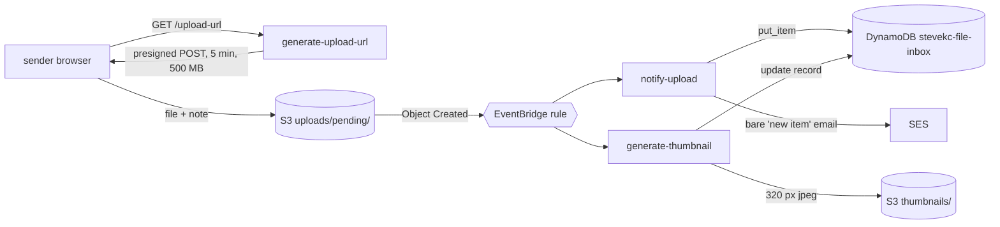
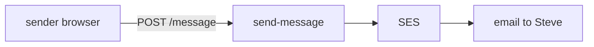
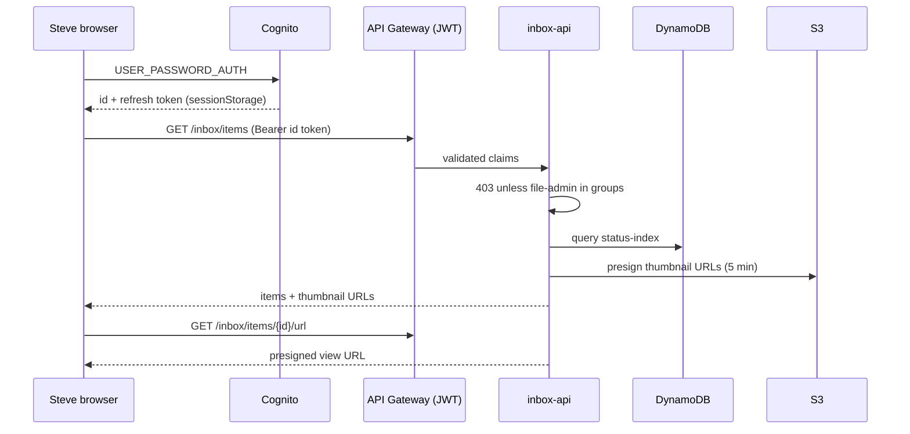
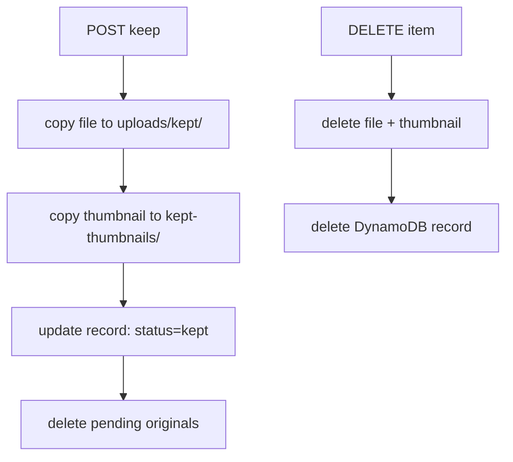

# Architecture

Account 258393933362, region ap-southeast-2. Three features share one HTTP API and one private bucket. Only `inbox-api` reads stored files, and only for the Cognito group `file-admin`.

## Upload flow (public)

## Message flow (public)

## Inbox flow (login required)

## Keep and delete

## Components

| Component | Name or ID | Job |
| --- | --- | --- |
| S3 website bucket | stevekc.com | static pages |
| CloudFront | E2T8UBLN7C8V11 | fronts the site; invalidate on every deploy |
| S3 private bucket | stevekc-uploads | uploads, kept files, thumbnails; no public access |
| HTTP API | sf06p1myta | `GET /upload-url`, `POST /message`, four `/inbox/items` routes |
| JWT authorizer | stevekc-cognito | validates the Cognito token on `/inbox/*` |
| EventBridge rule | stevekc-upload-pending-rule | fans each S3 Object Created under `uploads/pending/` out to two Lambdas |
| DynamoDB | stevekc-file-inbox | GSIs `status-index`, `s3Key-index` |
| Cognito | ap-southeast-2_a5VRRGNrH | groups `file-admin`, `family` |
| SES | stevekc.com identity | Easy DKIM, sends from notifications@stevekc.com |
| Lambda role | stevekc-upload-lambda-role | shared by all Lambdas |

## Security model

- Public actions are limited to uploading (presigned POST, 5 min, 1 byte to 500 MB) and sending a message.
- The authorizer validates the token; `inbox-api` then checks the group and returns 403 unless `file-admin` is present. HTTP APIs flatten array claims to a string like `[file-admin family]`, so the Lambda parses both shapes.
- The browser sends an `itemId` only, never an S3 key.
- Filenames and notes are untrusted: the inbox page builds the DOM with `textContent`, never `innerHTML`.
- View and thumbnail URLs are presigned for 5 minutes. The page reloads after 4 idle minutes.
- Tokens live in `sessionStorage`, so closing the tab signs out. The inbox page has `noindex` and no-referrer tags and is not linked from the homepage.
- Mail is sent from the verified stevekc.com domain with DKIM so Gmail DMARC passes. It contains no filename and no file link.

## Data model

DynamoDB item (`stevekc-file-inbox`, key `itemId`):

| Field | Meaning |
| --- | --- |
| itemId | UUID, the only id the browser sees |
| s3Key | current object key |
| filename | stored name, prefixed with the upload epoch |
| contentType, size | set at ingest; corrected from the extension when S3 reports binary/octet-stream |
| uploadTimestamp | when notify-upload ran |
| note | text the sender typed (`x-amz-meta-note`) |
| status | `pending` or `kept` |
| tags | lowercase, up to 20 tags of 30 characters |
| thumbnailKey | set for images |

S3 prefixes in `stevekc-uploads`:

| Prefix | Holds | Expiry |
| --- | --- | --- |
| `uploads/pending/` | new uploads | 90 days |
| `thumbnails/` | thumbnails of pending items | 90 days |
| `uploads/kept/` | kept files | none |
| `kept-thumbnails/` | thumbnails of kept items | none |

## Open items

- Thumbnail race: if the thumbnail Lambda runs before notify-upload writes the record, the thumbnail is made but not linked.
- Self-service change-password in the inbox.
- Wife and kids Cognito users (+home aliases), added later.
- Garage door access for `family` is built in the garage project.
- One-time or timed share link for a single file (needs a DynamoDB token table for true one-time use).
- A `/tools` folder on the site.
